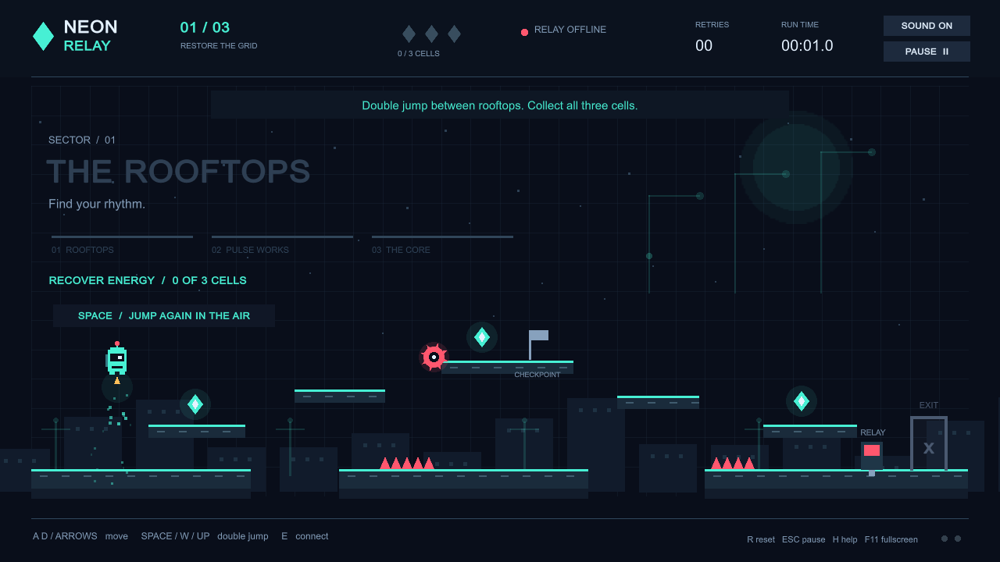

# Neon Relay

A small, complete 2D precision platformer built in **Unity 6.5 (6000.5.10f1)** from Unity Hub's Universal 2D template.

You are a little maintenance robot bringing a dark city back online. Recover three energy cells in each sector, solve its power-routing clue at the terminal, and reach the exit. Three stages introduce moving platforms, patrolling saws, spikes, gaps, and timed lasers.



## Download and play on Windows

[Download Neon Relay 1.1 for Windows x64](https://github.com/ogunmefun/2d-project/releases/download/v1.1.0/NeonRelay-Windows-v1.1.0.zip).

Extract the **whole ZIP**, then open **`NeonRelay.exe`** inside the extracted folder. Keep its data folder and DLLs together. Unity is not required to play the download.

Version 1.1 adds sector scenery, a city that lights up as you restore power, jump/landing/collection effects, live objectives, laser cycle indicators, optional puzzle hints, a field manual, reduced effects, fullscreen, and a per-sector results summary. See the [submission guide](Docs/SUBMISSION.md) for the game design, demo walkthrough, and hand-in contents, and [verification details](Docs/VERIFICATION.md) for the recorded checks.

Verified: **43 gameplay checks**, **30 executable checks**, and a Windows build with **zero errors and zero warnings**.

## Play in Unity

1. Clone or download this repository.
2. In **Unity Hub → Add → Add project from disk**, choose the **`Neon Relay`** folder (the folder containing `Assets`, `Packages`, and `ProjectSettings`).
3. Open with **6000.5.10f1**. Allow the first package import to finish.
4. Open **`Assets/Scenes/NeonRelay.unity`**, press Unity's **Play** button, then click **Start the run** or press **Enter** in the Game view.

## Controls

| Action | Keyboard |
| --- | --- |
| Move | A / D or left / right arrows |
| Jump; jump again in the air | Space, W, or up arrow |
| Shorter jump | Release the jump key early |
| Connect to a nearby relay | E |
| Toggle relay lines | 1 / 2 / 3, or click the switches |
| Submit routing / continue | Enter, or click the button |
| Pause / close relay panel | Escape |
| Restart current sector | R |
| Toggle sound | M |
| Field manual and options | H (from title, gameplay, or pause) |
| Toggle borderless fullscreen | F11 |

The two dots in the bottom right show your available jumps. Touch the flag on the middle rooftop to set a checkpoint. Falls and hazards return you there and preserve collected cells and restored relay power. You have unlimited retries. Restarting a sector resets its collectibles and checkpoint; its elapsed time and retries still count toward the run.

Laser labels communicate their state as well as color: **SAFE** is safe to cross, **WAIT** warns of the next pulse, and **LIVE** is harmful. Bars show each laser's cycle progress. The game pauses when the window loses focus. Opening the manual during gameplay also pauses; returning from the manual keeps the pause menu open until you resume.

The manual includes sound, reduced decorative effects, and fullscreen options. Reduced effects disable spark bursts, the death flash, and animated background circuitry; moving hazards remain animated so their position stays readable. Personal best completion time, sound, and reduced effects preferences are saved locally. Puzzle hints reveal a solution when needed, with no penalty. The end screen shows every sector's time and retries, including attempts before a sector reset.

Run time measures active platforming time; menus, pause, and circuit-solving time are excluded.

## Build and verify

In Unity, use the **Neon Relay** menu:

- **Run gameplay checks** runs deterministic movement, collision, hazard, checkpoint, circuit, and three complete level-route checks.
- **Build Windows (with checks)** produces `Neon Relay/Builds/Windows/NeonRelay.exe` and the companion data files.
- **Build WebGL (with checks)** builds to `Neon Relay/Builds/WebGL` when the matching WebGL module is installed. Serve a WebGL build through HTTP rather than opening its HTML as a local file.

The checks traverse every sector with actual movement and jump input, collect every cell, solve every circuit, deliberately respawn at each checkpoint, then reach each exit. Additional isolated checks place the player at edge cases to test spikes, pits, locked exits, and jump limits.

For an already open editor, PowerShell can request these actions:

```powershell
.\Tools\request.ps1 verify
.\Tools\request.ps1 windows
```

Results appear in the ignored `artifacts` folder. With the editor closed, batch mode is also supported:

```powershell
& 'C:\Program Files\Unity\Hub\Editor\6000.5.10f1\Editor\Unity.exe' `
  -batchmode -quit -projectPath "$PWD\Neon Relay" `
  -executeMethod NeonRelay.Editor.BuildTools.VerifyAndBuild `
  -logFile "$PWD\build.log"
```

The Windows executable also includes an opt-in smoke test. This exercises the title and manual, movement, jumps, pause/resume, restart, all three relay interfaces, sector transitions, final results, and replay; it saves screenshots and exits. Use a fresh output directory and keep its window focused while the test runs:

```powershell
& '.\Neon Relay\Builds\Windows\NeonRelay.exe' -smokeTest "$PWD\artifacts\runtime" -logFile "$PWD\artifacts\runtime\player.log"
```

The relay and completion UI smoke tests set up the robot and objectives directly to isolate those interfaces; the editor's route checks separately prove all three terminals and exits are reachable through movement. Synthetic completion restores the previous personal best when the test exits.

After verifying a Windows build, `Tools/package-windows.ps1 -Version 1.1.0` packages the player and documentation, excludes debug files, checks the packaged game assembly against the build, and writes a ZIP checksum. It refuses to overwrite an existing version's package.

## Project layout

| File | Purpose |
| --- | --- |
| `Assets/Scripts/GameSimulation.cs` | Fixed 120 Hz movement, collisions, double jump, checkpoints, hazards, and win conditions |
| `Assets/Scripts/LevelCatalog.cs` | The three stage layouts, moving platforms, laser timing, and circuit clues |
| `Assets/Scripts/NeonRelayGame.cs` | Keyboard input, procedural 2D drawing, menus, HUD, generated sound effects, and local best time |
| `Assets/Scripts/GamePresentation.cs` | Sector scenery, bounded spark effects, live objectives, field manual/options, and final run summary |
| `Assets/Scripts/RuntimeSmokeTest.cs` | Opt-in standalone player keyboard/UI checks and screenshot capture |
| `Assets/Editor/GameChecks.cs` | Deterministic gameplay regression and complete-route checks |
| `Assets/Editor/BuildTools.cs` | Main scene setup, build configuration, editor menus, and batch build entry points |

The game uses a custom axis-aligned kinematic simulation and Unity's IMGUI drawing, with a fixed 1280 × 720 design canvas that scales to the window. Geometry, robot art, UI shapes, and audio are generated in code. No paid assets, API keys, server, or downloaded art are required. Unity's Input System package handles keyboard input.

Unity-generated `Library`, `Temp`, `Logs`, `UserSettings`, and builds are excluded from source control. `.meta` files and the package lock file are included so scene references and package versions are reproducible.
